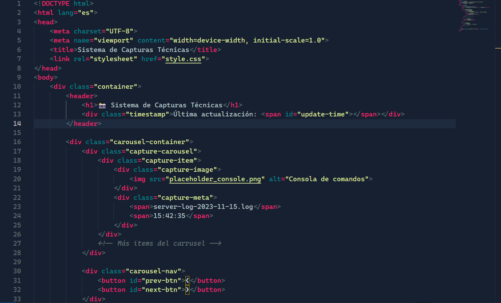
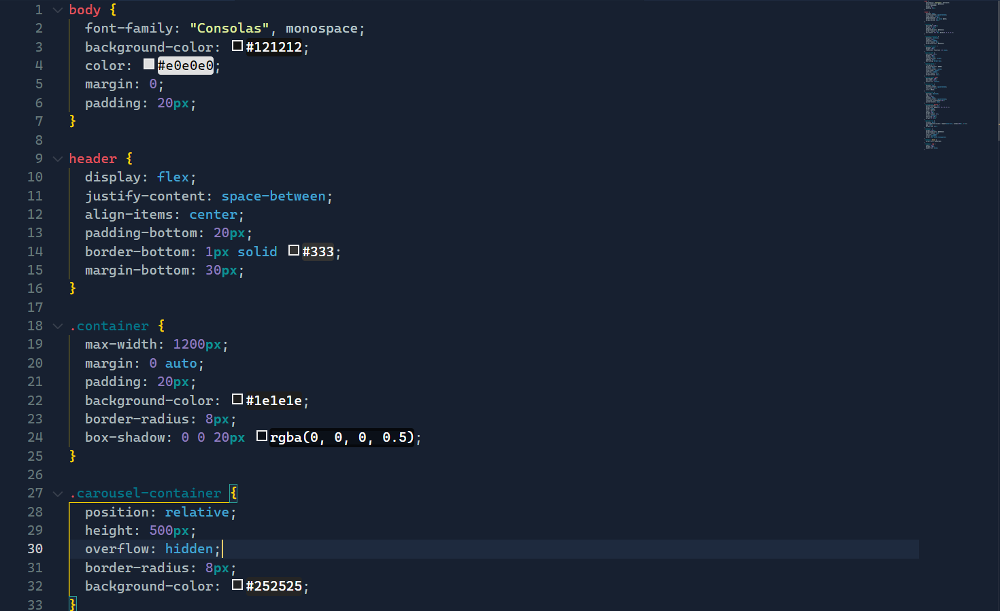
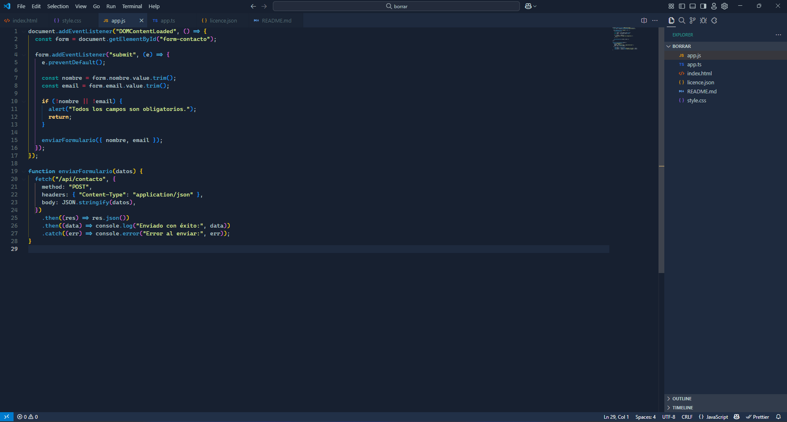
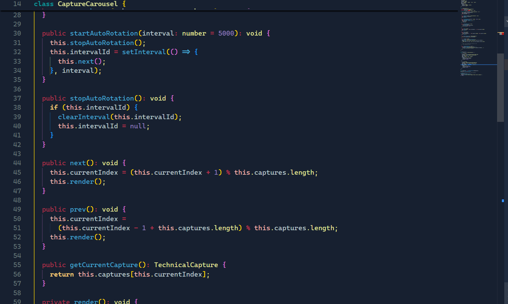
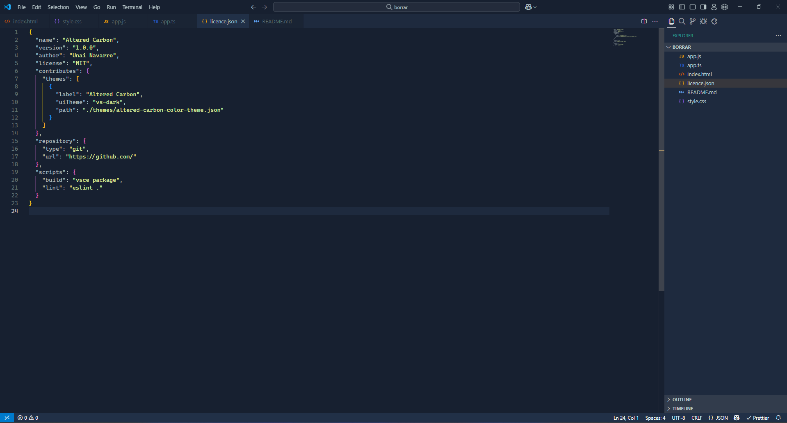
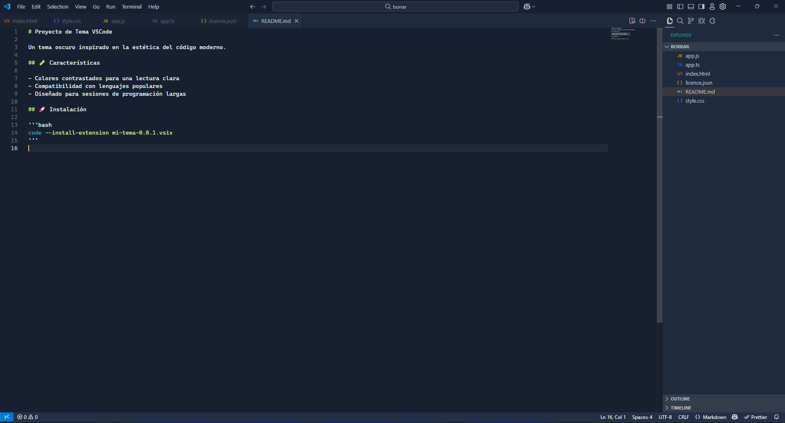

<h1 align = "center">Altered Carbon Theme</h1>

Altered Carbon es un tema oscuro para Visual Studio Code inspirado en el esquema de colores del tema Carbon de IntelliJ IDEA. Su objetivo es ofrecer una experiencia de desarrollo limpia, moderna y agradable a la vista, con una paleta de colores sobria y contrastes suaves que no cansan la vista.

## Galería

<table>
  <tr>
    <td></td>
    <td></td>
  </tr>
  <tr>
    <td></td>
    <td></td>
  </tr>
  <tr>
    <td></td>
    <td></td>
  </tr>
</table>

## Instalación

1. Descarga el archivo `.vsix` ➡️ [Altered Carbon](https://github.com/u-n-a-i/altered-carbon-theme/releases/download/v1.0.0/altered-carbon-0.0.1.vsix).
2. Abre VSCode.
3. Presiona `Ctrl+Shift+P` y escribe: `Extensions: Install from VSIX...`.
4. Selecciona el archivo descargado.
5. Aplica el tema desde `Preferences: Color Theme`.