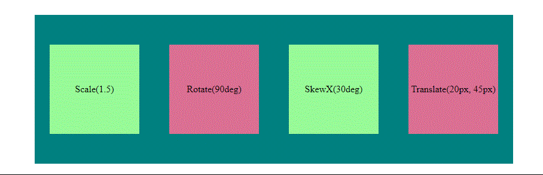

<div class="markdown-notes">

<div class="markdown title-container">
    <h1 align='center' class="title">Transformaciones</h1>
</div>

<div class="glosario-toggle">
     <input type="checkbox" id="toggle-glosario" class="toggle-input">
     <label for="toggle-glosario" class="toggle-label">📑 Índice</label>
     <div class="glosario-content">

- [Transformaciones](#transformaciones)
  - [Valores de la propiedad transform(2d)](#valores-de-la-propiedad-transform2d)

</div>
</div>

## Transformaciones

Las trasformaciones `transform` nos permiten modificar el espacio de coordenadas. Con esta propiedad podemos hacer que los elementos roten, sean escalados o sesgados.

### Valores de la propiedad transform(2d)

- `translate()`: Mover elementos en el ejeX(horizontal) y/o ejeY(vertical).
- `scale()`: Escala el elemento haciéndolo más grande o pequeño.
- `rotate()`: Gira los elementos en el ejeX(horizontal) y/o ejeY(vertical).
- `skewX()` y `skewY()`: Deforma/inclina el elemento sobre su eje.

Ejemplos:

```html
<!-- HTML -->
<div class="wrapper">
  <div class="caja">Scale(1.5)</div>
  <div class="caja">Rotate(90deg)</div>
  <div class="caja">SkewX(30deg)</div>
  <div class="caja">Translate(20px, 45px)</div>
</div>
```

```css
/* CSS */
.wrapper {
  width: 800px;
  height: 250px;
  margin: 200px auto;
  background-color: teal;
  display: flex;
  justify-content: space-around;
  align-items: center;
}

.caja {
  display: flex;
  justify-content: center;
  align-items: center;
}

.caja:nth-child(odd) {
  width: 150px;
  height: 150px;
  background-color: palegreen;
}

.caja:nth-child(even) {
  width: 150px;
  height: 150px;
  background-color: palevioletred;
}

.caja:nth-child(1):hover {
  transform: scale(1.5);
}

.caja:nth-child(2):hover {
  transform: rotate(90deg);
}

.caja:nth-child(3):hover {
  transform: skewX(30deg);
}

.caja:nth-child(4):hover {
  transform: translate(20px, 45px);
}
```


