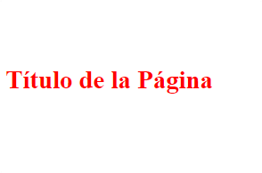

<div class="markdown-notes">

<div class="markdown title-container">
    <h1 align='center' class="title">Cascada</h1>
</div>

<div class="glosario-toggle">
     <input type="checkbox" id="toggle-glosario" class="toggle-input">
     <label for="toggle-glosario" class="toggle-label">📑 Índice</label>
     <div class="glosario-content">

- [Cascada](#cascada)
- [Etapas](#etapas)
- [Ejemplo](#ejemplo)

</div>
</div>

## Cascada

CSS lee la información en cascada. Si aplicas dos estilos distintos al mismo elemento se aplicara el ultimo estilo.

## Etapas

El algoritmo en cascada se divide en varias etapas:

- **Posición y orden de aparición:** Es el orden en el que aparecen tus reglas CSS.
- **Especificidad:** Un algoritmo que determina qué selector de CSS tiene la puntuación más fuerte.
- **Origen:** El orden y la procedencia en el que se importa.
- **Importancia:** Dependiendo la puntuación que tengan algunas reglas CSS tienen más peso que otras.

## Ejemplo

```html
<!-- HTML -->
<h1>Título de la Página</h1>
```

```css
/* CSS */
h1 {
  color: blue;
}

h1 {
  color: red;
}
```

**Resultado**



</div>
