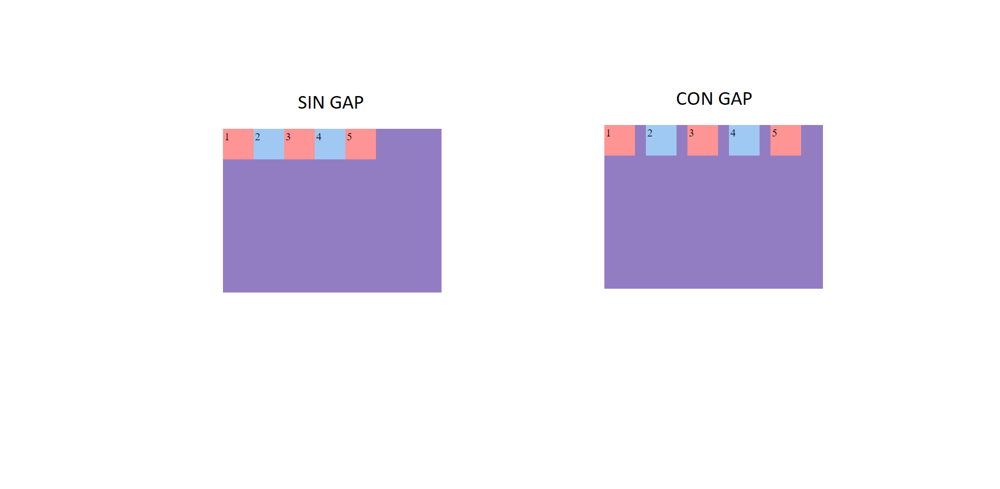

<div class="markdown-notes">

<div class="markdown title-container">
    <h1 align='center' class="title">Gap</h1>
</div>

<div class="glosario-toggle">
     <input type="checkbox" id="toggle-glosario" class="toggle-input">
     <label for="toggle-glosario" class="toggle-label">📑 Índice</label>
     <div class="glosario-content">

- [Gap](#gap)
  - [Ejemplo](#ejemplo)

</div>
</div>

## Gap

Gap es la propiedad abreviada de row-gap y column-gap. Esta propiedad nos permite controlar el espacio entre elementos. El espacio no se aplica en la parte externa de los elementos.

```css
/* Espacio de 20px a las filas y columnas */
gap: 20px;
/* Espacio de 20px a las filas y 30px columnas */
gap: 20px 30px;
```

### Ejemplo

```html
<!-- HTML -->
<div class="flex-container">
  <div class="flex-item">1</div>
  <div class="flex-item">2</div>
  <div class="flex-item">3</div>
  <div class="flex-item">4</div>
  <div class="flex-item">5</div>
</div>
```

```css
/* CSS */
.flex-container {
  width: 400px;
  height: 300px;
  margin: 15% auto;
  display: flex;
  flex-wrap: nowrap;
  gap: 20px;
  background-color: #937dc2;
}

.flex-item {
  width: 50px;
  height: 50px;
  padding: 3px;
  font-size: 20px;
}
.flex-item:nth-child(even) {
  background-color: #9fc9f3;
}

.flex-item:nth-child(odd) {
  background-color: #ff9494;
}
```


