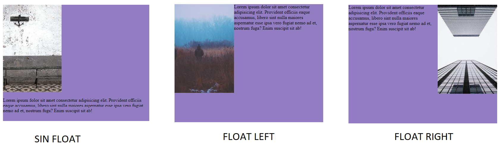

<div class="markdown-notes">

<div class="markdown title-container">
    <h1 align='center' class="title">Float</h1>
</div>

<div class="glosario-toggle">
     <input type="checkbox" id="toggle-glosario" class="toggle-input">
     <label for="toggle-glosario" class="toggle-label">📑 Índice</label>
     <div class="glosario-content">

- [Float](#float)
- [Limitaciones de float](#limitaciones-de-float)
- [Clear](#clear)

</div>
</div>

## Float

La propiedad `float` hace que los elementos floten permitiendo que otros elementos se coloquen a su lado. Lo mejor que se puede hacer con esta propiedad es aprender Flexbox y Grid para evitar usarla. Lo recomendable es maquetar con flex y grid pero es necesario saber como funciona float por si te encuentras algún proyecto que lo utilice.

Ejemplo:

```html
<!-- HTML -->
<div class="wrapper">
  
  <p>
    Lorem ipsum dolor sit amet consectetur adipisicing elit. Provident officiis
    eaque accusamus, libero sint nulla maiores aspernatur esse ipsa vero fugiat
    nemo ad et, nostrum fuga? Enim suscipit sit ab!
  </p>
</div>
```

```css
/* CSS */

.wrapper {
  width: 500px;
  height: 400px;
  margin: 50px auto;
  background-color: #937dc2;
}
img {
  float: right;
}
```



Como la imagen y el párrafo son elementos en bloque no permiten que otros elementos se sitúen al lado de forma horizontal. <br>
Con `float: left;` los elementos flotaran a su izquierda y con `float: right;` los elementos flotaran a su derecha.

## Limitaciones de float

Tener claro que float fue diseñado inicialmente para flujos de texto alrededor de imágenes, no para maquetación de diseños complejos. Por eso hoy en día se prefieren tecnologías como **Flexbox y Grid**.

## Clear

La propiedad `clear` se utiliza para controlar el comportamiento de los elementos flotantes (aquellos que tienen la propiedad float aplicada). Cuando aplicas `clear` a un elemento, le indicas si debe situarse debajo de los elementos flotantes que se encuentran a su izquierda, a su derecha o en ambos lados.

Los valores principales de clear son:

- `left`: el elemento no estará junto a elementos flotantes a la izquierda.

- `right`: el elemento no estará junto a elementos flotantes a la derecha.

- `both`: el elemento evitará estar junto a elementos flotantes en ambos lados.

- `none`: no se aplicará ningún comportamiento especial relacionado con elementos

Por ejemplo, si tienes un diseño con elementos flotantes y quieres que un párrafo esté completamente debajo de ellos, puedes usar:

```css
p {
  clear: both;
}
```

</div>
