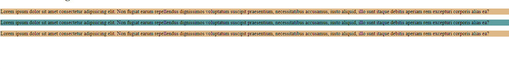

<div class="markdown-notes">

<div class="markdown title-container">
    <h1 align='center' class="title">Selectores</h1>
</div>

<div class="glosario-toggle">
     <input type="checkbox" id="toggle-glosario" class="toggle-input">
     <label for="toggle-glosario" class="toggle-label">📑 Índice</label>
     <div class="glosario-content">

- [¿Qué son los selectores?](#qué-son-los-selectores)
- [Selector de tipo](#selector-de-tipo)
- [Selector universal](#selector-universal)
- [HTML, global(\*) y body](#html-global-y-body)
  - [¿Por qué usar rem en el selector html?](#por-qué-usar-rem-en-el-selector-html)
- [Selector de clase e id](#selector-de-clase-e-id)

</div>
</div>

## ¿Qué son los selectores?

Los selectores CSS son patrones que se utilizan para seleccionar y aplicar estilos a elementos HTML en una página web. Los selectores permiten a los diseñadores y desarrolladores web especificar qué elementos deben ser afectados por las reglas de estilo CSS que definen el aspecto y el diseño de una página.

## Selector de tipo

Los selectores de tipo seleccionan todos los elementos que pertenezcan a ese tipo concreto.
Si quieres aplicar estilos a todos los encabezados `<h1>` se puede usar el selector de tipo `h1{Declaraciones}`. En resumen, seleccionar por etiquetas HTML.
Se puede aplicar una misma regla para varios tipos de selectores separándoles con comas. `h1,h2,h3 {propiedad: valor;}`

Ejemplo:

```css
/* Aplicar un tamaño de fuente y un color a todos los elementos del body*/
body {
  font-size: 20px;
  color: green;
}

/* Aplicar bordes a todos los encabezados h1*/
h1 {
  border: 3px solid black;
}
```

## Selector universal

El selector universal `*` sirve para seleccionar todos los elementos. Mediante este selector podemos aplicar estilos a todos los elementos de la página.

Ejemplo:

```css
/* Aplicar un tamaño de fuente y un color a todos los elementos */
* {
  font-size: 20px;
  color: green;
}
```

## HTML, global(\*) y body

Cuándo usar Global (\*)

- **Restablecer estilos por defecto:** Cuando deseas eliminar los márgenes, el relleno y otros estilos predeterminados del navegador para todos los elementos.
- **Estilos globales:** Cuando necesitas aplicar un estilo a todos los elementos, como el box-sizing o un color de borde común.
- **Selector \*:** Utilízalo para resetear o normalizar estilos en todos los elementos. Es particularmente útil al comienzo de un archivo CSS para asegurarte de que todos los elementos partan de un mismo punto base sin estilos predefinidos.

Cuándo usar HTML

- **Definir la base de los estilos globales:** Cuando necesitas establecer configuraciones globales que afectan a todo el documento, como la base del tamaño de la fuente (para unidades rem) y comportamientos globales como el desplazamiento suave.
- **Configuraciones de viewport:** Para estilos que afectan directamente al elemento raíz del documento HTML.
- **Selector html:** Utilízalo para establecer configuraciones globales como el tamaño de fuente base y el comportamiento de desplazamiento. Afecta al documento en su totalidad y establece la base para estilos relativos.

Cuándo usar Body

- **Estilos del contenido principal:** Cuando deseas aplicar estilos a todo el contenido visible de la página, como la configuración de la familia de fuentes, el color de fondo y los márgenes/paddings generales del documento.
- **Diseño global:** Para establecer estilos que afectan la apariencia y disposición del contenido en el `<body>`
- **Selector body:** Utilízalo para aplicar estilos al contenido principal del documento, como fuentes, colores de fondo y márgenes. Afecta a todos los elementos dentro del `<body>` y define la apariencia general de la página.

### ¿Por qué usar rem en el selector html?

La razón principal para definir las unidades rem en el selector html y no en body o \* tiene que ver con la naturaleza y el propósito específico de las unidades rem (root em).

```css
/* Correcto: Definir tamaño base de rem en html */
html {
  font-size: 16px; /* 1rem = 16px */
}

body {
  font-size: 1rem; /* Heredado, pero 1rem sigue siendo 16px */
}

p {
  font-size: 1.5rem; /* 1.5 * 16px = 24px */
}

/* Incorrecto: Definir tamaño base de rem en body (no afecta rem) */
body {
  font-size: 16px; /* 1rem sigue siendo el tamaño de fuente del html */
}

p {
  font-size: 1.5rem; /* 1.5 * tamaño de fuente del html, no del body */
}
```

## Selector de clase e id

Los selectores de clase e Id sirven para agrupar e identificar elementos HTML y aplicar un estilo.
No se puede usar el mismo nombre para varios ids.
Se puede usar los selectores descendientes con clases e ids. Para las clases se usa un . delante del nombre y para los id se usa # delante del nombre.

Sintaxis(HTML):

```html
<h1 class="nombre-de-la-clase">Título de la Página</h1>

<h1 id="nombre-del-id">Título de la Página</h1>
```

Sintaxis(CSS):

```css
.nombre-de-la-clase {
  propiedad: valor;
}

#nombre-del-id {
  propiedad: valor;
}
```

> ✍️ Nota
>
> - Las clases se pueden aplicar a varios elementos, el ID no.
> - Los ID tienen mayor especificidad que las clases.
> - Selector de Clase = .
> - Selector de Id = #

Ejemplo:

```html
<!-- HTML -->
<p class="parrafos_secundarios">
  Lorem ipsum dolor sit amet consectetur adipisicing elit. Non fugiat earum
  repellendus dignissimos voluptatum suscipit praesentium, necessitatibus
  accusamus, iusto aliquid, illo sunt itaque debitis aperiam rem excepturi
  corporis alias ea?
</p>

<p id="parrafos_principal">
  Lorem ipsum dolor sit amet consectetur adipisicing elit. Non fugiat earum
  repellendus dignissimos voluptatum suscipit praesentium, necessitatibus
  accusamus, iusto aliquid, illo sunt itaque debitis aperiam rem excepturi
  corporis alias ea?
</p>

<p class="parrafos_secundarios">
  Lorem ipsum dolor sit amet consectetur adipisicing elit. Non fugiat earum
  repellendus dignissimos voluptatum suscipit praesentium, necessitatibus
  accusamus, iusto aliquid, illo sunt itaque debitis aperiam rem excepturi
  corporis alias ea?
</p>
```

```css
/* CSS */
#parrafos_principal {
  background-color: cadetblue; /*Azul*/
}

.parrafos_secundarios {
  background-color: burlywood; /*Marron*/
}
```

**Resultado:**



</div>
