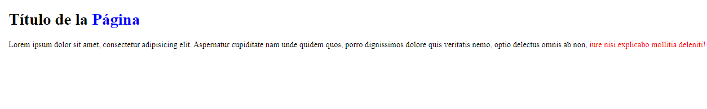
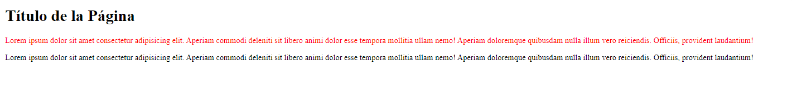
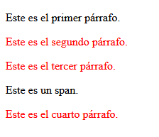

<div class="markdown-notes">

<div class="markdown title-container">
    <h1 align='center' class="title">Selectores combinados</h1>
</div>

<div class="glosario-toggle">
     <input type="checkbox" id="toggle-glosario" class="toggle-input">
     <label for="toggle-glosario" class="toggle-label">📑 Índice</label>
     <div class="glosario-content">

- [Selector descendiente](#selector-descendiente)
- [Selector adyacente](#selector-adyacente)
- [Selector de hermano general](#selector-de-hermano-general)

</div>
</div>

## Selector descendiente

Los selectores descendiente seleccionan los elementos que se encuentran dentro de otros elementos. El estilo solo se aplicara a los elementos que se encuentren dentro del elemento padre.
Para seleccionar solo los hijos directos se puede usar el mayor que >(selector hijo) entre los selectores `p > span`.

Ejemplo:

Aplicar un color azul a todos los `<span>` y un color rojo a los que se encuentran dentro de un párrafo.

- **Selector descendiente:** con un espacio en blanco entre selectores.
  - `div p ` selecciona todos los párrafos que están dentro de un div, aunque haya otros elementos entre ellos.
- **Selector hijo:** con un mayor que > entre selectores.
  - `div > p` selecciona solo los párrafos que son hijos directos de un div, sin incluir los que están dentro de otros elementos.

```html
<h1>Título de la <span>Página</span></h1>

<p>
  Lorem ipsum dolor sit amet, consectetur adipisicing elit. Aspernatur
  cupiditate nam unde quidem quos, porro dignissimos dolore quis veritatis nemo,
  optio delectus omnis ab non,
  <span>iure nisi explicabo mollitia deleniti!</span>
</p>
```

```css
span {
  color: blue;
}
p span {
  color: red;
}
```

**Resultado:**



## Selector adyacente

Los selectores adyacentes (+) seleccionan solo los elementos que van precedidos por el primer elemento.

```html
<!-- HTML -->
<h1>Título de la Página</h1>

<p>
  Lorem ipsum dolor sit amet consectetur adipisicing elit. Aperiam commodi
  deleniti sit libero animi dolor esse tempora mollitia ullam nemo! Aperiam
  doloremque quibusdam nulla illum vero reiciendis. Officiis, provident
  laudantium!
</p>

<p>
  Lorem ipsum dolor sit amet consectetur adipisicing elit. Aperiam commodi
  deleniti sit libero animi dolor esse tempora mollitia ullam nemo! Aperiam
  doloremque quibusdam nulla illum vero reiciendis. Officiis, provident
  laudantium!
</p>
```

```css
/* CSS */
h1 + p {
  color: red;
}
```

**Resultado:**



## Selector de hermano general

El selector de hermano general `~` selecciona todos los elementos que son hermanos del primer elemento especificado y vienen después de él en el árbol del documento. Es decir, selecciona todos los elementos que están en el mismo nivel (comparten el mismo padre) y que siguen al elemento indicado.

```html
<div>
  <p class="parrafo1">Este es el primer párrafo.</p>
  <p class="parrafo2">Este es el segundo párrafo.</p>
  <p class="parrafo3">Este es el tercer párrafo.</p>
  <span>Este es un span.</span>
  <p class="parrafo4">Este es el cuarto párrafo.</p>
</div>
```

```css
.parrafo1 ~ p {
  color: red;
}
```

**Resultado:**



> ✍️ Nota
>
> El selector de hermano general ~ se usa comúnmente junto con elementos de formulario, como los checkboxes (input[type="checkbox"]), para mostrar y ocultar contenido en función del estado del checkbox. Esto se puede lograr sin necesidad de JavaScript, utilizando solo CSS.
>
> ```html
> <input type="checkbox" id="toggle" />
> <label for="toggle">Mostrar/Ocultar contenido</label>
> <div class="contenido">
>   <p>Este es el contenido que se mostrará o se ocultará.</p>
> </div>
> ```
>
> ```css
> .contenido {
>   display: none; /* Ocultar el contenido por defecto */
> }
>
> #toggle:checked ~ .contenido {
>   display: block; /* Mostrar el contenido cuando el checkbox está marcad > */
> }
> ```

</div>
